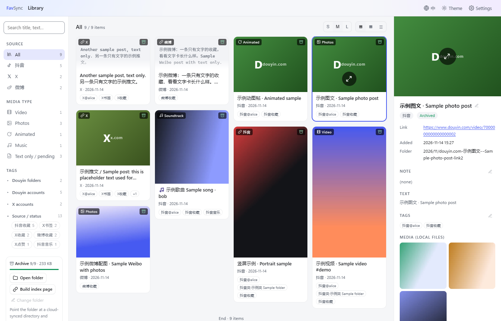
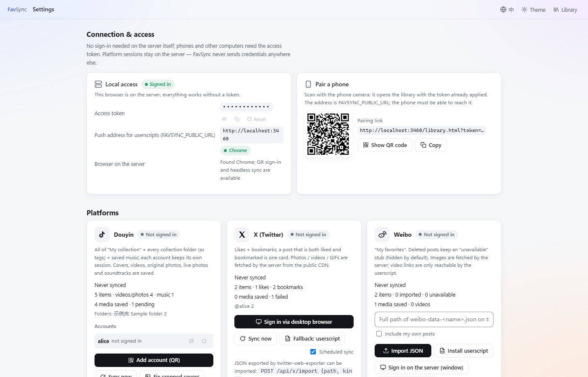
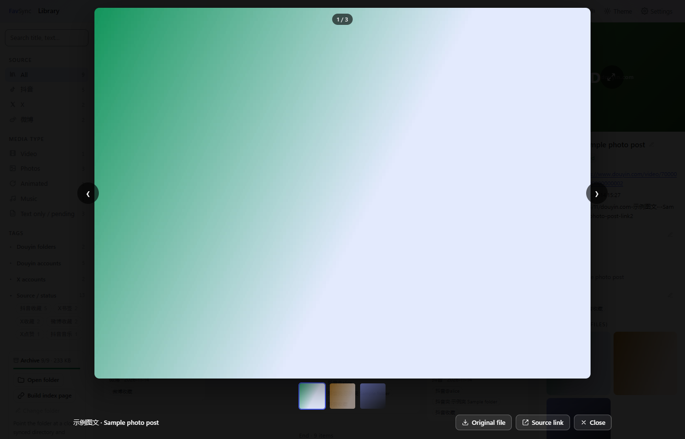
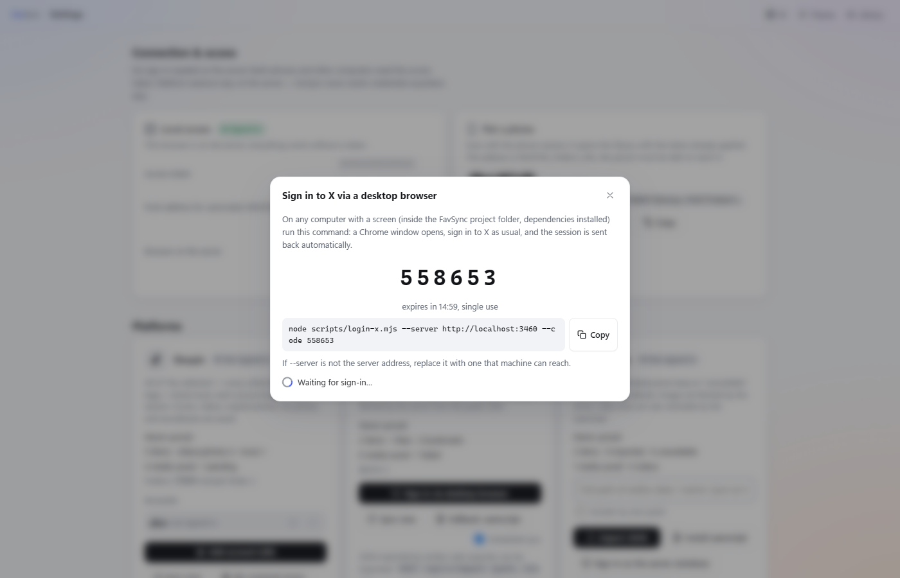
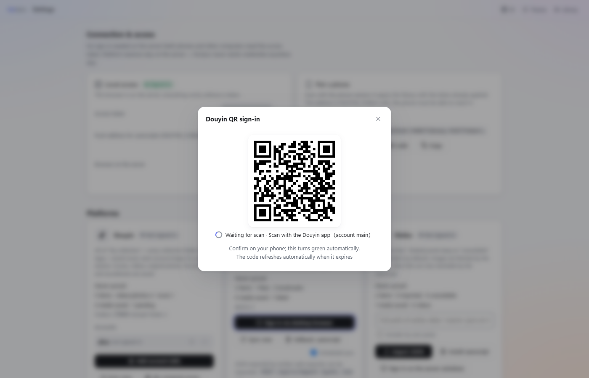
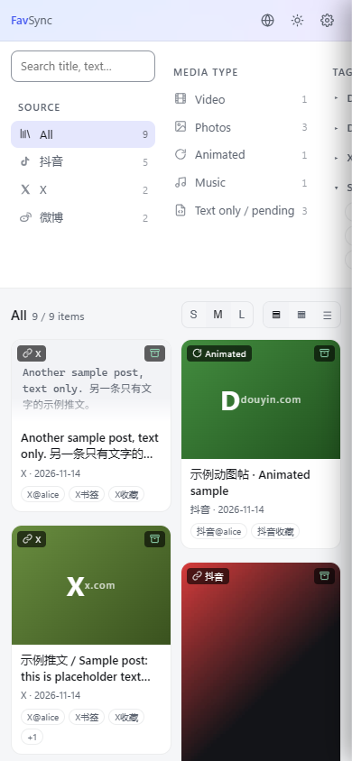

# FavSync

**English** · [中文](README.zh-CN.md)

A self-hosted archiver for your own favorites on **Douyin** (collections, collection folders, saved music — multiple accounts), **Weibo** (favorites) and **X / Twitter** (likes + bookmarks). Sign in once, and FavSync syncs every 12 hours and stores every item as **plain files on disk**: `readable.md`, `metadata.json`, cover, original photos (GIF / animated WebP kept as-is), live-photo clips, `video.mp4`, `audio.mp3`.

It ships with an Eagle-style three-pane library (filters / masonry / inspector) and writes a static `index.html` into the archive root, so you can browse everything even without FavSync running.

> When a site gets blocked, a video is taken down, an account disappears or a link expires — you still have the content. That is the only purpose of this project.

Single user, self-hosted, one Node.js process, SQLite via the built-in `node:sqlite` module. No Docker, no database server.



---

## Why

- A "favorite" on a platform is not yours. The author deletes a post, the platform takes one down, or the whole site becomes unreachable — your collection turns into a list of grey placeholders.
- Most "save this video" tools work one link at a time. FavSync is **continuous**: sign in once, it pages through your favorites on a schedule, new items flow in, media files are fetched gradually in the background.
- What you save must **outlive the tool**: no database blobs, no proprietary format. One folder per item with an obvious structure, cloud-sync friendly, readable by any file manager.
- **Never deletes**: items removed upstream are kept locally. "Remove from library" in the UI only deletes the database row; files on disk stay.

## Platforms and how sign-in works

| Platform | What is collected | Sign-in | Media |
|---|---|---|---|
| Douyin | Everything in "My collection" + every collection folder (as tags) + saved music; **multiple accounts** | Settings → "Add account": the server starts a headless browser, extracts the login QR code and shows it in the web UI → **scan with the Douyin app** (works on a server without a display) | Downloaded by the server through each account's own session: cover / animated cover / video / original photos / live photos / soundtrack |
| Weibo | "My favorites" (deleted posts keep an "unavailable" stub) | ① a one-time browser window on the server (needs a display) ② import JSON exported by [Weibo-archiver](https://github.com/Chilfish/Weibo-archiver) ③ userscript | Images fetched by the server with a Referer; video URLs are only reachable by the userscript running in your browser |
| X (Twitter) | Likes + bookmarks (a post that is both is one card); multiple accounts | Settings → "Sign in via desktop browser" gives a 15-minute code → on **any computer with a screen** run `node scripts/login-x.mjs --server <server> --code <code>` → sign in to X in the Chrome window that opens → the session is sent back to the server | Fetched by the server from the public CDN: original images / highest-bitrate mp4 / GIFs |

Each platform also has a **userscript** (Tampermonkey / Violentmonkey) as a fallback: it runs in the browser you are already signed in with, for people who do not want a session stored on the server.

## Anti-ban rules (written into every code path)

1. **Zero extra requests.** Both the server-side sync and the userscripts only *listen* to the responses the page itself makes while scrolling. They never assemble API calls or touch signatures (Douyin's `a_bogus` / `msToken` etc.).
2. **Scroll like a human.** Random 1.8–3.5 s between scrolls, a 5–10 s rest every 8 scrolls, a cap per run.
3. **Download like a human.** One file at a time, random 1–3 s between files, an 8–15 s rest every 10 files.
4. **Stop on the first sign of trouble.** HTTP 403 / 429, a captcha on the page, or three consecutive download failures → stop immediately, record it, retry on the next scheduled run. Never hammer.
5. **Skip expired links.** Douyin video / image URLs live for a dozen hours; expired ones are skipped (not counted as failures) until the next list sync refreshes them (`urlExpiry`).
6. **Only your own favorites.** No liked-list, no watch history, no other people's profiles.

Automated access may still violate a platform's terms of service and your account may be flagged. Use it only to back up your own favorites and do not make the pacing faster than the defaults.

## Install and run

Requirements: **Node.js ≥ 22.5** (built-in `node:sqlite`; 24 recommended) and **Chrome or Edge** installed on the machine (Playwright reuses the system browser; nothing is downloaded). ffmpeg ships with `ffmpeg-static` and is used for thumbnails and video-frame covers.

```bash
git clone https://github.com/CorCvusRamboChen/favsync.git
cd favsync
npm install
npm start            # http://localhost:3460
```

Open `http://localhost:3460/settings.html` and follow the cards. After the first sign-in click "Sync now" once; from then on it runs every 12 hours.

Access from the server itself needs no sign-in. Phones and other computers need the access token — shown under *Connection & access* in Settings, or scan the pairing QR code there and the library opens with the token applied.

## Screenshots

| | |
|---|---|
|  |  |
|  |  |



The UI is bilingual (中文 / English, toggle in the header, follows the browser language by default) and has light / dark themes. Screenshots use generated placeholder content.

## Project layout

```
favsync/
├─ src/
│  ├─ server.js              HTTP layer: pages, API, userscript delivery, thumbnails, /archive static files
│  ├─ background-jobs.js     scheduled jobs: 12-hour sync, Weibo image fetch, X media fetch
│  ├─ db.js                  node:sqlite wrapper (WAL, busy_timeout)
│  ├─ store.js               items + tags + media-type facets (items / tags / taggings / archives)
│  ├─ archive.js             archive root, folder naming, status, static index.html
│  ├─ auth.js                local = no auth / remote token / pairing link / install codes / login tickets
│  ├─ thumbs.js              ffmpeg thumbnail cache, video-frame covers
│  ├─ events.js              SSE live refresh
│  ├─ net-guard.js           SSRF guard
│  ├─ connectors/
│  │  ├─ favorites-archive.js  text archive + media files + magic-number checks + /archive URL encoding
│  │  ├─ douyin-favorites.js   normalize, ingest, multi-account, folders, music, headless sync, media, expiring links, cover rebuild
│  │  ├─ weibo-favorites.js    two export shapes, retweet dedupe, unavailable detection, server-side images, headless sync
│  │  ├─ x-favorites.js        GraphQL tweet shapes, cookie session, headless bookmarks/likes, CDN media
│  │  ├─ social-sync.js        scheduler: per-site isolation, need_login bookkeeping, media after-phase
│  │  └─ browser-profiles.js   persistent-profile queue (one Chrome per profile dir) + browser detection
│  └─ userscripts/           three userscripts (server injects address + token; panel text zh/en)
├─ scripts/
│  ├─ douyin-login-qr.mjs    headless QR export for Douyin sign-in (servers without a display)
│  ├─ login-x.mjs            sign in to X on a machine with a screen, send cookies to the server
│  ├─ login-site.mjs         open a browser window on the server for Weibo / Douyin
│  ├─ douyin-media-loop.sh   drain pending Douyin media in batches (auto-rest on rate limit, re-sync when links expire)
│  └─ shot-local.mjs         headless page screenshot (debugging)
├─ public/                   library.html / settings.html + css / js (i18n.js holds the zh/en dictionary)
├─ test/                     node:test — `npm test`
├─ data/                     runtime data (SQLite, browser profiles, state json, thumbnail cache) — gitignored
└─ ~/FavSync/archive/        archive root (default): year/month/site-title-linkN/
```

One folder per item inside the archive:

```
2026/10/douyin.com-title-link123/
├─ readable.md        title, source link, author, text, account, folders
├─ metadata.json      machine-readable original fields
├─ cover.jpg          cover (portrait videos get a full-frame cover rebuilt from the video)
├─ cover-anim.webp    animated cover
├─ video.mp4
├─ image-01.jpg …     original photos; GIF / animated WebP kept as image-NN.gif / image-NN.anim.webp
├─ live-01.mp4 …      live photos / animated clips
└─ audio.mp3          soundtrack / saved music
```

## Environment variables

| Variable | Default | Meaning |
|---|---|---|
| `PORT` | `3460` | listen port |
| `FAVSYNC_DATA` | `<project>/data` | runtime data directory |
| `FAVSYNC_DB` | `<data>/app.db` | SQLite file |
| `FAVSYNC_ARCHIVE` | `~/FavSync/archive` | archive root (also changeable in Settings, stored in `data/archive.json`) |
| `FAVSYNC_TOKEN` | generated, stored in `data/token.json` | access token for remote access / userscripts / login scripts |
| `FAVSYNC_PUBLIC_URL` | `http://localhost:<PORT>` | address userscripts push to and the pairing QR encodes (required when the server is another machine) |
| `FAVSYNC_SYNC_HOURS` | `12` | scheduled sync interval |
| `FAVSYNC_NO_JOBS` | unset | `1` disables background jobs |
| `FAVSYNC_THUMBS` | `<data>/thumbs` | thumbnail cache |
| `FAVSYNC_FFMPEG` | bundled `ffmpeg-static` | custom ffmpeg path |
| `FAVSYNC_BROWSER_PROFILE` / `FAVSYNC_BROWSER_PROFILES` | `<data>/browser-profile`, `<data>/browser-profiles/` | default account profile / root for other accounts' profiles |
| `FAVSYNC_DOUYIN_ACCOUNTS` / `FAVSYNC_SOCIAL_SYNC` / `FAVSYNC_X_SYNC` | `<data>/*.json` | state file locations (mainly for test isolation) |

## API

No auth on the server itself; remote callers send `Authorization: Bearer <token>` or `?token=`. Endpoints marked **token** require the token even locally (so that arbitrary web pages cannot push into localhost).

**Library**
- `GET /api/library?tag=&exclude_tag=&source=&media=&q=&limit=&offset=` → `{stats, tags, items[]}` (each item carries `archive.{dir, files}`)
- `GET /api/library/items/:id` · `PATCH /api/library/items/:id {title, note}` · `DELETE /api/library/items/:id` (record only, files kept)
- `POST /api/library/tags {item_id, tags}`
- `GET /api/archive` · `POST /api/archive/root {root}` · `POST /api/archive/index` (write static index) · `POST /api/archive/flag-anim`
- `GET /thumb/<archive-relative-path>?w=400` · `GET /archive/...` · `GET /api/events` (SSE)

**Auth**
- `GET /api/health` · `GET /api/auth/whoami` → `{local, browser, public_url}`
- `GET /api/auth/token` (local only) → `{token, pair_url, qr}` · `POST /api/auth/token/reset` (local only) · `GET /api/qr?text=`

**Douyin**
- `POST /api/douyin/push {items, music, account, folders}` (token) · `GET /api/douyin/pending` (token) · `POST /api/douyin/media/:awemeId?kind=cover|anim|video|image|live|audio&index=` (token, octet-stream) · `POST /api/douyin/media/:awemeId/failed` (token)
- `GET /api/douyin/status` · `POST /api/douyin/sync {account:'all'|id, mode:'all'|'folders', full, max_items, media_limit, video, skip_list, max_ms}` · `POST /api/douyin/fix-covers`
- `GET /api/douyin/accounts` · `DELETE /api/douyin/accounts/:id` · `POST /api/douyin/login/start {account?}` · `GET /api/douyin/login/status?account=` → `{state: starting|qr|logged_in|timeout|error, qr}`

**Weibo**
- `POST /api/weibo/push {items}` (token) · `GET /api/weibo/pending` (token) · `POST /api/weibo/media/:weiboId?kind=&index=` (token) · `POST /api/weibo/media/:weiboId/failed` (token)
- `GET /api/weibo/status` · `POST /api/weibo/import {path, include_own}` (local) · `POST /api/weibo/media/fetch {limit}`

**X**
- `POST /api/x/push {items, kind:'like'|'bookmark', account}` (token) · `GET /api/x/status` · `POST /api/x/import {path, kind, account}` (local) · `POST /api/x/media/fetch`
- `POST /api/x/ticket` → code · `POST /x-login {code, cookies, handle}` (called by the login script; outside /api) · `POST /api/x/sync {full}` · `POST /api/x/logout`

**Schedule / userscripts**
- `GET /api/social/status` · `POST /api/social/sync {sites, full, force}` · `POST /api/social/settings {douyin_enabled, weibo_enabled, x_enabled}` · `POST /api/social/login {site}` (local, opens a window)
- `POST /api/userscript/install-link {script: douyin|weibo|x}` → 24-hour install link · `GET /install/:code/<name>.user.js`

## FAQ

**Douyin media stays `stale` / does not download.** The direct links expired (the video CDN path carries an expiry; image hosts use `x-expires`). That is normal: run a list or folder sync again (`POST /api/douyin/sync {mode:'folders', media_limit:0}`) to refresh the URLs, then fetch. `scripts/douyin-media-loop.sh` does this automatically.

**Covers / downloads return 403.** Either the session expired (Settings shows it in red — scan again) or you were rate-limited; the sync already stopped. Wait a few hours; do not shorten the interval. Remote images on cards use `referrerpolicy=no-referrer` to get past hotlink protection.

**My server has no display. How do I sign in?** Douyin: "Add account" shows the QR code in the web page — scan it with the app. X: get a code, run `scripts/login-x.mjs` on any machine with a screen; the cookies are sent back. Weibo: currently needs a browser window on the server (VNC / remote desktop works), or use the userscript / import a Weibo-archiver export.

**The userscript will not install / cannot push.** The script embeds your token, so it is only served to the server itself or through the 24-hour install link from Settings. When the server is another machine, set `FAVSYNC_PUBLIC_URL` first, then reinstall.

**Covers are blank in the library.** Archive paths contain non-ASCII characters and `#` and must be URL-encoded per segment; on startup FavSync idempotently normalizes old `/archive/...` paths in the database to exactly one level of encoding.

**"Cannot open the browser" with the same Chrome profile.** Only one Chrome instance can use a profile directory; `browser-profiles.js` queues launches and waits for the previous one to close (up to 10 minutes) before giving up.

**Portrait video covers are cropped.** Douyin's API `cover` is a 323:430 center crop; `origin_cover` is full-frame. When only the cropped one exists, a full-frame cover is rebuilt from the downloaded video with ffmpeg (Settings also has a "Fix cropped covers" button).

**Port already in use / wrong Node version.** The server prints a clear message and exits: set `PORT=xxxx`, or upgrade to Node ≥ 22.5. If no Chrome / Edge is found, Settings shows a warning on every card that needs a browser.

## Development

```bash
npm test                       # node:test, fully offline, temporary databases
FAVSYNC_NO_JOBS=1 npm start    # without background jobs
node scripts/shot-local.mjs http://localhost:3460/library.html out.png   # headless screenshot
```

When a platform changes its response shape, adjust `normalize*` and the `*_RE` patterns in the matching connector; the test fixtures are real-world shapes. UI strings live in `public/js/i18n.js`; a test checks that the zh and en dictionaries have identical keys.

## Credits

- [Eagle](https://eagle.cool/), [TagStudio](https://github.com/TagStudioDev/TagStudio), [karakeep](https://github.com/karakeep-app/karakeep): the three-pane library layout, tag-first organization, masonry / grid / list views.
- [ArchiveBox](https://github.com/ArchiveBox/ArchiveBox): redundant formats, plain files, archives that remain readable without the tool.
- [DouyinDataReview](https://github.com/ZhangYukwiver/DouyinDataReview): "never treat collection time as the real time" — publish time, favorite time and sync time are kept apart.
- [Weibo-archiver](https://github.com/Chilfish/Weibo-archiver): the Weibo favorites endpoint and mblog field notes; FavSync imports its export files directly.
- [twitter-web-exporter](https://github.com/prinsss/twitter-web-exporter): the shape of X export JSON.

MIT License · © CorCvusRamboChen
