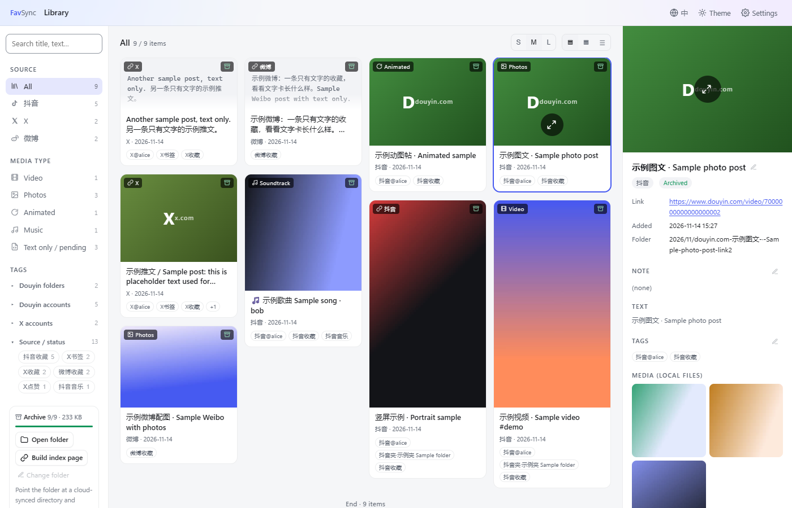
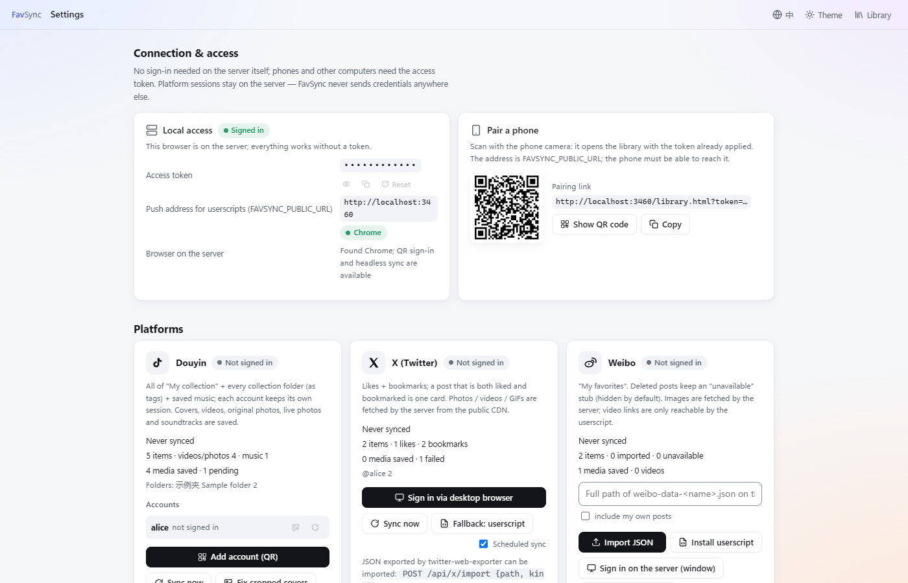
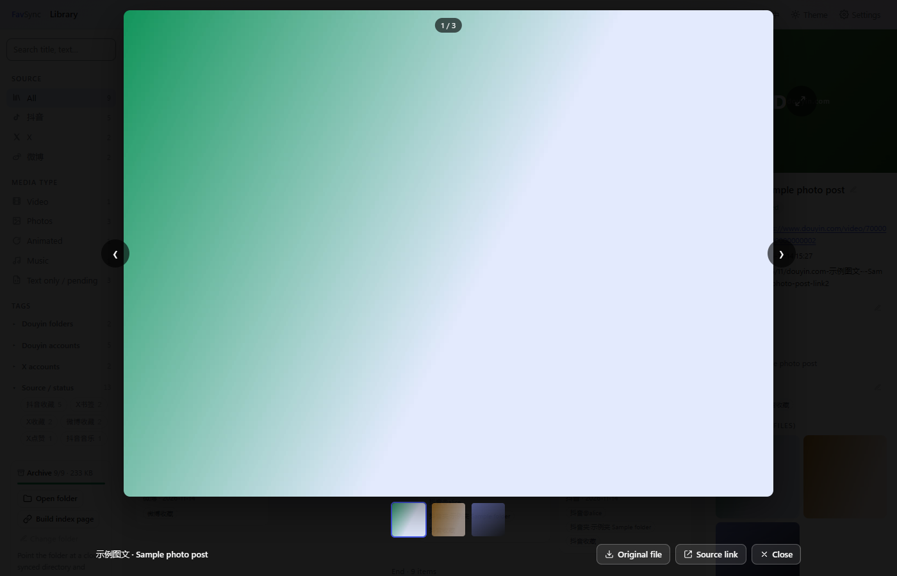
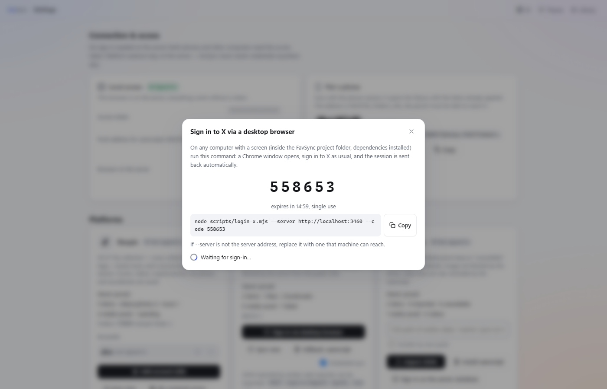
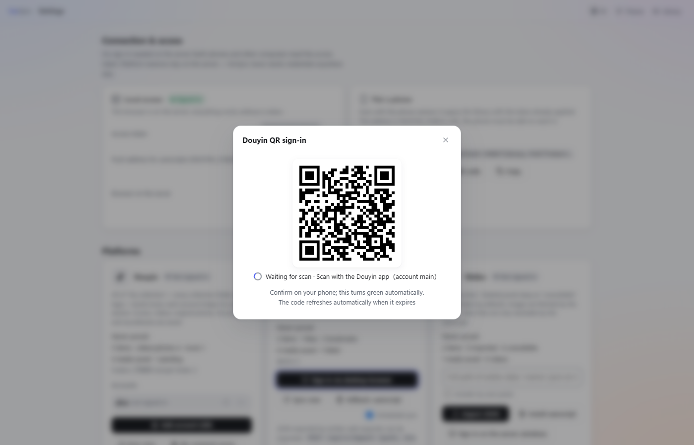
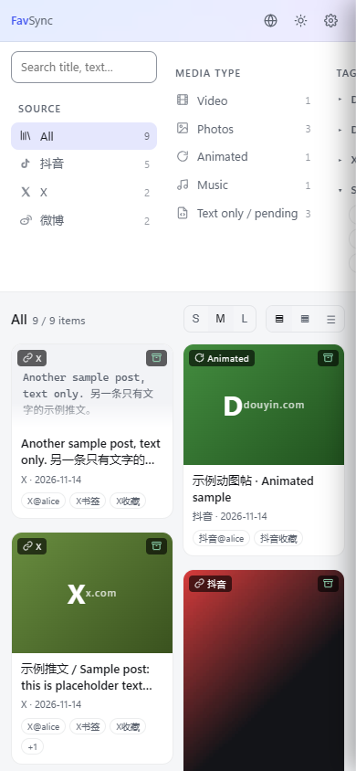

# FavSync

[English](README.md) · **中文**

把 **抖音的收藏（含收藏夹、收藏的音乐，支持多账号）、微博的收藏、X（Twitter）的点赞和书签** 自动同步到你自己的电脑上，每一条都存成**硬盘上的普通文件**：正文 `readable.md`、`metadata.json`、封面、图文原图（GIF / 动态 WebP 原样保留）、实况短片、视频 `video.mp4`、配乐 / 音乐 `audio.mp3`。

附带一个 Eagle 风格的三栏收藏库页面（筛选 / 瀑布流 / 检视器），并在存档根目录生成纯静态的 `index.html`——不跑 FavSync 也能翻存档。

> 站点被封、视频被删、账号没了、链接过期——你手里还有内容。这是这个项目唯一的目的。

单用户、自托管、Node.js 一个进程，SQLite 用内置的 `node:sqlite`，不需要 Docker、不需要数据库服务。



---

## 为什么

- 平台上的「收藏」不是你的：作者删一条、平台下架一条、哪天整个站打不开，收藏夹里就只剩灰色的壳。
- 现有的"保存视频"工具大多一次一条、要自己贴链接；FavSync 是**常态化**的：登录一次，之后每 12 小时自己去翻，新收藏自动进来，媒体文件在后台慢慢补齐。
- 存下来的东西要**能脱离这个工具活下去**：不进数据库 blob、不用私有格式，目录结构一眼能懂，云盘可以直接同步，资源管理器能翻，别的程序能读。
- **防删**：原站删了的条目这里不删；你在收藏库里"移出"一条，也只是删数据库记录，硬盘上的文件不动。

## 支持的平台与登录方式

| 平台 | 收什么 | 登录方式 | 媒体怎么下 |
|---|---|---|---|
| 抖音 | 「我的收藏」全部 + 每个收藏夹（打成标签）+ 收藏的音乐；**多账号** | 设置页「添加账号」→ 服务端无头浏览器把登录二维码导出来显示在网页上 → **手机抖音扫码**（服务器没屏幕也行） | 服务端用各账号自己的登录态在无头浏览器里下：封面 / 动态封面 / 视频 / 图文原图 / 实况 / 配乐 |
| 微博 | 「我的收藏」（原微博已删的也留一条「已失效」壳） | ① 在服务器上弹出浏览器登录一次（要有屏幕）② 导入 [Weibo-archiver](https://github.com/Chilfish/Weibo-archiver) 导出的 JSON ③ 油猴脚本 | 图片服务端带 Referer 直接下；视频直链只有浏览器里的脚本拿得到 |
| X（Twitter） | 点赞 + 书签（同一条推既点赞又书签只有一张卡）；多账号 | 设置页「用电脑浏览器登录」拿一个 15 分钟口令 → 在**任何有屏幕的电脑**上跑 `node scripts/login-x.mjs --server <服务器地址> --code <口令>` → 弹出的 Chrome 里正常登录 → 登录态自动发回服务器 | 服务端直接从公开 CDN 下：原图 / 最高码率 mp4 / 动图 |

三个平台都另有一份**油猴脚本**（Tampermonkey / Violentmonkey）作为备用：在你自己平时登着的浏览器里跑，适合不想在服务器上留登录态的人。

## 风控原则（写进了每一行代码）

1. **零额外请求**：服务端同步和油猴脚本都只"旁听"页面自己翻收藏时发出的响应，从不自己拼接口、不碰签名（抖音的 a_bogus / msToken 之类）。
2. **翻页像人**：每次滚动随机等 1.8–3.5 秒，每 8 次歇 5–10 秒，每轮有上限。
3. **下载像人**：媒体一个一个来，中间随机 1–3 秒，每 10 个歇 8–15 秒。
4. **限流即停**：接口回 403 / 429、页面冒出验证码、连续 3 次下载失败 → 立刻停下并记录，下一轮再来，绝不硬刷。
5. **直链过期跳过**：抖音的视频 / 图片直链只活十几个小时，过期的条目直接跳过、不计失败，等下一次列表同步刷新地址（`urlExpiry`）。
6. **只收你自己的收藏**：喜欢列表、浏览历史、别人的主页一概不碰。

即便如此，自动化访问仍可能违反平台的服务条款，账号也可能被风控。请只用于备份你自己的收藏，节奏别调得比默认更快。

## 安装与运行

要求：**Node.js ≥ 22.5**（用到了内置的 `node:sqlite`，推荐 24）、本机装有 **Chrome 或 Edge**（Playwright 复用系统浏览器，不下载 Chromium）。ffmpeg 由 `ffmpeg-static` 自带，用来做缩略图和从视频抽封面。

```bash
git clone https://github.com/CorCvusRamboChen/favsync.git
cd favsync
npm install
npm start            # http://localhost:3460
```

打开 `http://localhost:3460/settings.html`，按卡片上的提示登录想同步的平台。登录完点一次「现在同步」，之后每 12 小时自动跑。

服务器本机访问免验证；手机 / 别的电脑访问要带访问令牌——在设置页「连接与授权」里能看到，或者用手机扫那里的配对二维码，打开的收藏库会自动带上令牌。

## 截图

| | |
|---|---|
|  |  |
|  |  |



界面中英双语（页头切换，默认跟随浏览器语言），有浅色 / 深色主题。

## 目录结构

```
favsync/
├─ src/
│  ├─ server.js              HTTP 层：页面、接口、油猴脚本分发、缩略图、/archive 静态目录
│  ├─ background-jobs.js     定时任务：12 小时同步、微博补图、X 补媒体
│  ├─ db.js                  node:sqlite 封装（WAL、busy_timeout）
│  ├─ store.js               条目 + 标签 + 媒体类型分面（items / tags / taggings / archives）
│  ├─ archive.js             存档根目录、目录命名、状态、纯静态 index.html
│  ├─ auth.js                本机免验证 / 远程令牌 / 配对链接 / 安装码 / 登录口令
│  ├─ thumbs.js              ffmpeg 缩略图缓存、从视频抽封面
│  ├─ events.js              SSE 实时刷新
│  ├─ net-guard.js           SSRF 防护
│  ├─ connectors/
│  │  ├─ favorites-archive.js  文本存档 + 媒体落盘 + 文件头（魔数）校验 + /archive 路径编码
│  │  ├─ douyin-favorites.js   抖音：整形、入库、多账号、收藏夹、音乐、无头同步、媒体下载、直链过期、封面重做
│  │  ├─ weibo-favorites.js    微博：两种导出形状、转发去重、已失效识别、服务端补图、无头同步
│  │  ├─ x-favorites.js        X：GraphQL 推文整形、cookie 登录态、无头翻书签页 / 点赞页、CDN 下媒体
│  │  ├─ social-sync.js        定时调度：每站独立、need_login 记录、after 阶段补媒体
│  │  └─ browser-profiles.js   持久 profile 排队启动（同一目录同时只开一个 Chrome）+ 浏览器检测
│  └─ userscripts/           三份油猴脚本（服务端分发时注入地址和令牌；面板文案中英）
├─ scripts/
│  ├─ douyin-login-qr.mjs    无头导出抖音登录二维码（服务器没屏幕时用）
│  ├─ login-x.mjs            有屏幕的电脑上登录 X，把 cookie 投回服务器
│  ├─ login-site.mjs         在服务器上弹窗口登录微博 / 抖音
│  ├─ douyin-media-loop.sh   把待下的抖音媒体分批补完（限流自动歇、直链全过期自动重翻）
│  └─ shot-local.mjs         无头截图页面（排查用）
├─ public/                   library.html / settings.html + css / js（i18n.js 是中英字典）
├─ test/                     node:test，`npm test`
├─ data/                     运行时数据（SQLite、登录态 profile、各站状态 json、缩略图缓存），已 gitignore
└─ ~/FavSync/archive/        存档目录（默认），年/月/站点-标题-link编号/
```

存档目录里每条收藏一个文件夹：

```
2026/10/douyin.com-标题-link123/
├─ readable.md        标题、原始链接、作者、正文、收藏账号、收藏夹
├─ metadata.json      机器可读的原始字段
├─ cover.jpg          封面（竖屏视频会用视频帧重做完整画幅）
├─ cover-anim.webp    动态封面
├─ video.mp4          视频
├─ image-01.jpg …     图文原图；动图保留为 image-NN.gif / image-NN.anim.webp
├─ live-01.mp4 …      实况 / 动图短片
└─ audio.mp3          配乐 / 收藏的音乐
```

## 环境变量

| 变量 | 默认 | 说明 |
|---|---|---|
| `PORT` | `3460` | 监听端口 |
| `FAVSYNC_DATA` | `<项目>/data` | 运行时数据目录 |
| `FAVSYNC_DB` | `<data>/app.db` | SQLite 文件 |
| `FAVSYNC_ARCHIVE` | `~/FavSync/archive` | 存档根目录（也可在设置页改，写进 `data/archive.json`） |
| `FAVSYNC_TOKEN` | 自动生成，存 `data/token.json` | 远程访问 / 油猴脚本 / 登录脚本用的访问令牌 |
| `FAVSYNC_PUBLIC_URL` | `http://localhost:<PORT>` | 油猴脚本推送地址、配对二维码里的地址（服务跑在别的机器上时必填） |
| `FAVSYNC_SYNC_HOURS` | `12` | 定时同步间隔（小时） |
| `FAVSYNC_NO_JOBS` | 空 | 设为 `1` 不启动后台任务 |
| `FAVSYNC_THUMBS` | `<data>/thumbs` | 缩略图缓存目录 |
| `FAVSYNC_FFMPEG` | `ffmpeg-static` 自带 | 自定义 ffmpeg 路径 |
| `FAVSYNC_BROWSER_PROFILE` / `FAVSYNC_BROWSER_PROFILES` | `<data>/browser-profile`、`<data>/browser-profiles/` | 默认账号的浏览器 profile / 其它账号的 profile 根目录 |
| `FAVSYNC_DOUYIN_ACCOUNTS` / `FAVSYNC_SOCIAL_SYNC` / `FAVSYNC_X_SYNC` | `<data>/*.json` | 各状态文件位置（主要给测试隔离用） |

## API 一览

本机免验证；远程带 `Authorization: Bearer <token>` 或 `?token=`。标「令牌」的接口即使在本机也必须带令牌（防止任意网页往 localhost 灌数据）。

**收藏库**
- `GET /api/library?tag=&exclude_tag=&source=&media=&q=&limit=&offset=` → `{stats, tags, items[]}`（每条带 `archive.{dir, files}`）
- `GET /api/library/items/:id` · `PATCH /api/library/items/:id {title, note}` · `DELETE /api/library/items/:id`（只删记录，不删文件）
- `POST /api/library/tags {item_id, tags}`
- `GET /api/archive` · `POST /api/archive/root {root}` · `POST /api/archive/index`（生成静态索引页）· `POST /api/archive/flag-anim`
- `GET /thumb/<存档相对路径>?w=400` 缩略图 · `GET /archive/...` 存档文件 · `GET /api/events` SSE

**鉴权**
- `GET /api/health` · `GET /api/auth/whoami` → `{local, browser, public_url}`
- `GET /api/auth/token`（本机）→ `{token, pair_url, qr}` · `POST /api/auth/token/reset`（本机）· `GET /api/qr?text=`

**抖音**
- `POST /api/douyin/push {items, music, account, folders}`（令牌）· `GET /api/douyin/pending`（令牌）· `POST /api/douyin/media/:awemeId?kind=cover|anim|video|image|live|audio&index=`（令牌，octet-stream）· `POST /api/douyin/media/:awemeId/failed`（令牌）
- `GET /api/douyin/status` · `POST /api/douyin/sync {account:'all'|id, mode:'all'|'folders', full, max_items, media_limit, video, skip_list, max_ms}` · `POST /api/douyin/fix-covers`
- `GET /api/douyin/accounts` · `DELETE /api/douyin/accounts/:id` · `POST /api/douyin/login/start {account?}` · `GET /api/douyin/login/status?account=` → `{state: starting|qr|logged_in|timeout|error, qr}`

**微博**
- `POST /api/weibo/push {items}`（令牌）· `GET /api/weibo/pending`（令牌）· `POST /api/weibo/media/:weiboId?kind=&index=`（令牌）· `POST /api/weibo/media/:weiboId/failed`（令牌）
- `GET /api/weibo/status` · `POST /api/weibo/import {path, include_own}`（本机）· `POST /api/weibo/media/fetch {limit}`

**X**
- `POST /api/x/push {items, kind:'like'|'bookmark', account}`（令牌）· `GET /api/x/status` · `POST /api/x/import {path, kind, account}`（本机）· `POST /api/x/media/fetch`
- `POST /api/x/ticket` → 口令 · `POST /x-login {code, cookies, handle}`（登录脚本调用，不在 /api 下）· `POST /api/x/sync {full}` · `POST /api/x/logout`

**定时 / 脚本**
- `GET /api/social/status` · `POST /api/social/sync {sites, full, force}` · `POST /api/social/settings {douyin_enabled, weibo_enabled, x_enabled}` · `POST /api/social/login {site}`（本机，弹窗口）
- `POST /api/userscript/install-link {script: douyin|weibo|x}` → 24 小时安装链接 · `GET /install/:code/<name>.user.js`

## 常见问题

**抖音媒体一直 `stale` / 下不动？** 直链过期了（视频 CDN 路径里带过期时间，图床用 `x-expires`），正常。重跑一次列表或收藏夹同步（`POST /api/douyin/sync {mode:'folders', media_limit:0}`）刷新地址再补。`scripts/douyin-media-loop.sh` 会自动做这件事。

**封面 / 下载回 403？** 要么登录态过期（设置页会亮红字，重新扫码），要么被限流了——同步器已经停下了，歇几个小时再来，别缩短间隔。图床的图在卡片上直连显示需要 `referrerpolicy=no-referrer`，页面已经带了。

**无头的服务器没有屏幕，怎么登录？** 抖音：设置页「添加账号」会把二维码显示在网页上，手机扫。X：拿口令后在任何有屏幕的电脑上跑 `scripts/login-x.mjs`，cookie 会发回服务器。微博：目前需要在服务器上弹一次窗口（有 VNC / 远程桌面也行），或者改用油猴脚本 / 导入 Weibo-archiver 的导出。

**油猴脚本装不上 / 推不过去？** 脚本文件里带着令牌，所以只能在服务器本机下载，或用设置页生成的 24 小时安装链接。服务跑在别的机器上时要先设 `FAVSYNC_PUBLIC_URL`，再重新安装脚本。

**收藏库里封面一片白？** 存档路径含中文和 `#`，必须按段 URL 编码；启动时会幂等地把库里旧的 `/archive/...` 路径统一成只编码一层。

**同一个 Chrome profile 报"开不了浏览器"？** 同一目录同时只能开一个实例，`browser-profiles.js` 会排队等上一个关掉；等 10 分钟还没空出来才报错。

**竖屏视频封面上下被裁？** 抖音接口的 `cover` 是 323:430 居中裁的，`origin_cover` 才是完整画幅；没有 `origin_cover` 时，视频下好后会自动用 ffmpeg 从视频抽一帧重做封面（设置页也有「修复裁切封面」按钮）。

**端口被占用 / Node 版本不够？** 服务会打印一句明白话然后退出：换 `PORT=xxxx`，或者升级到 Node ≥ 22.5。

## 开发

```bash
npm test                       # node:test，全部离线、用临时库
FAVSYNC_NO_JOBS=1 npm start    # 不跑后台任务
node scripts/shot-local.mjs http://localhost:3460/library.html out.png   # 无头截图
```

抖音 / 微博 / X 的接口形状变了，先改对应 connector 里的 `normalize*` 和 `*_RE`；测试里的 fixture 就是实测过的形状。

## 致谢

- [Eagle](https://eagle.cool/)、[TagStudio](https://github.com/TagStudioDev/TagStudio)、[karakeep](https://github.com/karakeep-app/karakeep)：收藏库三栏布局、标签为主的分类、瀑布流 / 网格 / 列表切换的思路。
- [ArchiveBox](https://github.com/ArchiveBox/ArchiveBox)：多格式冗余、普通文件、脱离工具可读的存档原则。
- [DouyinDataReview](https://github.com/ZhangYukwiver/DouyinDataReview)：「不把采集时间当真实时间」——发布时间、收藏时间、同步时间分开记。
- [Weibo-archiver](https://github.com/Chilfish/Weibo-archiver)：微博收藏接口与 mblog 字段的整理；FavSync 能直接导入它的导出文件。
- [twitter-web-exporter](https://github.com/prinsss/twitter-web-exporter)：X 导出 JSON 的形状。

MIT License · © CorCvusRamboChen
